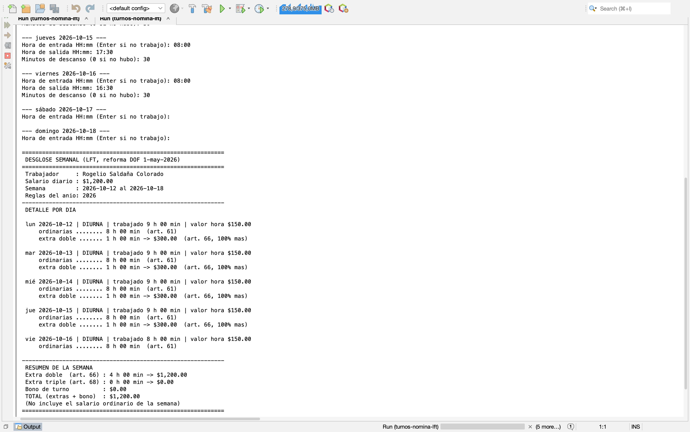
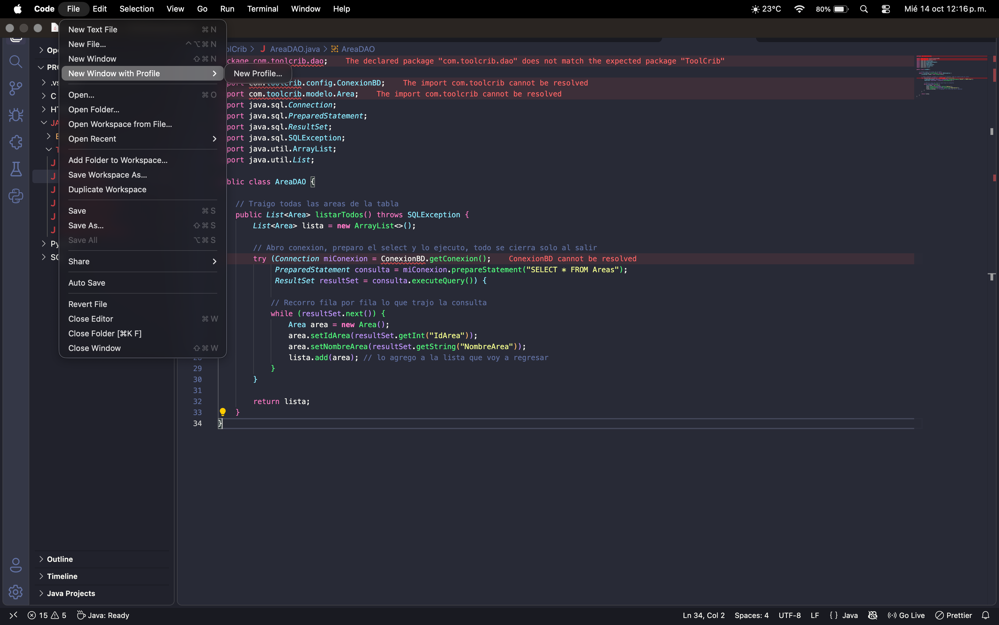

# turnos-nomina-lft

Calculadora de **horas extra y bono por turno** según la Ley Federal del Trabajo reformada (decreto del DOF del 1 de mayo de 2026). Java puro, sin base de datos, con interfaz de consola y de ventana (Swing).

## Qué es

Programa que recibe la entrada, la salida y el descanso de cada día de una semana y calcula cuánto se paga en horas extra dobles, horas extra triples y bono de turno. Muestra un **desglose línea por línea** con el artículo de ley de cada concepto.

## Problema que resuelve

Calcular a mano las horas extra es propenso a errores: los topes cambian cada año de 2026 a 2030, hay turnos diurnos, nocturnos y mixtos, y algunos turnos cruzan la medianoche. El programa aplica las reglas por año y deja claro de dónde sale cada importe.

Ejemplo: salario diario $520, lunes a jueves de 8:00 a 19:30 y viernes de 8:00 a 16:30 (30 min de descanso) en 2026 → 9 h extra dobles + 3 h triples = **$1,755.00**.

## Capturas

| Consola | Ventana (Swing) |
|---|---|
|  |  |

## Stack

- Java 21 y Maven
- Swing (interfaz gráfica)
- JUnit 5 (8 casos de prueba)
- NetBeans y Git/GitHub

## Cómo correrlo

Requisitos: **JDK 21** y Maven.

```bash
mvn compile
java -cp target/classes com.rogelio.turnosnominalft.TurnosNominaLft
```

Aparece un menú: `1` calcula en consola y `2` abre la ventana. En NetBeans basta con presionar *Run*. Fechas en formato `AAAA-MM-DD` y horas `HH:mm` en 24 horas. Para las pruebas: `mvn test`.

## Arquitectura en una línea

`ui → calculo → modelo / reglas`: la pantalla solo pregunta y muestra, el cálculo hace las cuentas y los números de la ley viven únicamente en `reglas`.

## Más documentación

- [Reglas de la ley y supuestos](docs/reglas.md)
- [Casos de prueba (cálculo a mano vs programa)](docs/casos-de-prueba.md)
- [Arquitectura explicada para no técnicos](docs/arquitectura-turnos-nomina-lft.docx)

No incluye ISR, prima dominical, séptimo día ni días festivos. No es asesoría legal.

Proyecto de aprendizaje de Rogelio Saldaña Colorado (ITIID, UPSLP).